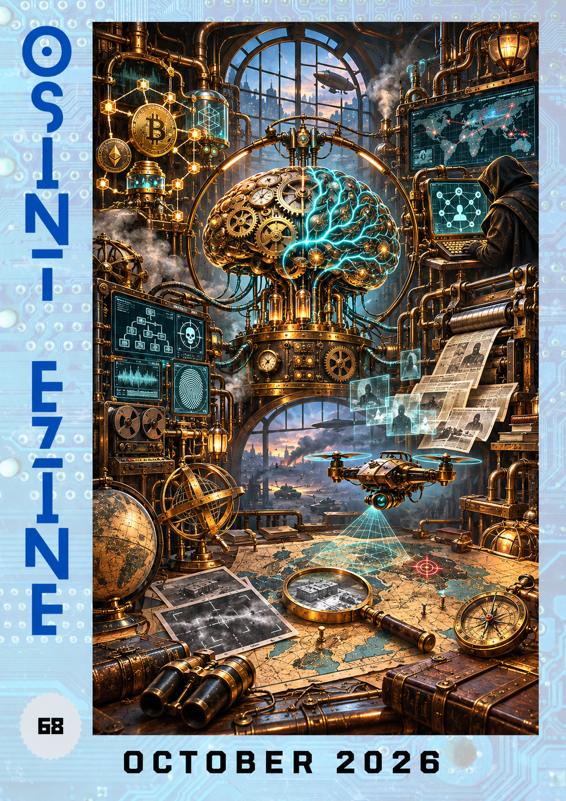

# 10 - October 2026

<figure><figcaption></figcaption></figure>

Welcome to the October issue of the OSINT eZine ([_#68_](https://therealguyinblack.gitbook.io/osint-ezine/osint-ezine/2026)). This issue includes topics such as security vulnerabilities and geopolitical biases in AI-generated code; benchmarks of AI agents for blockchain investigations; the largest cryptocurrency theft in history, attributed to North Korea; digital evidence preservation and chain of custody; covert influence operations using AI; MITRE ATT\&CK expanding to cover AI systems; cyberattacks and compromised Tor exit relays; the growing capabilities of LLMs in geolocation investigations; the risks of misleading screenshot timestamps; the geolocation of a drone strike in Mali; an open-source alternative to Office, Adobe... and much more!

Hey Ho, Lets Go!:

* [AI: Geopolitical Bias in Qwen3-Coder.](10-october-2026.md#ai-geopolitical-bias-in-qwen3-coder)
* [Crypto: AI Agents for Blockchain Investigations.](10-october-2026.md#crypto-ai-agents-for-blockchain-investigations)
* [Crypto: North Korea Behind the $6.4 Billion Binance Hack.](10-october-2026.md#crypto-north-korea-behind-the-usd6.4-billion-binance-hack)
* [Learning: OSINT Chain of Custody.](10-october-2026.md#learning-osint-chain-of-custody)
* [Learning: OSINT for Law Enforcement.](10-october-2026.md#learning-osint-for-law-enforcement)
* [News: MITRE ATT\&CK Expands to AI Systems.](10-october-2026.md#news-mitre-att-and-ck-expands-to-ai-systems)
* [News: OpenAI Disrupts Covert Influence Operations.](10-october-2026.md#news-openai-disrupts-covert-influence-operations)
* [Privacy: A Wave of Cyberattacks Across Europe.](10-october-2026.md#privacy-a-wave-of-cyberattacks-across-europe)
* [Privacy: Tor Exit Relays Compromised for Credential Theft.](10-october-2026.md#privacy-tor-exit-relays-compromised-for-credential-theft)
* [Techniques: AI-Assisted Geolocation: Humans Remain Essential.](10-october-2026.md#techniques-ai-assisted-geolocation-humans-remain-essential)
* [Techniques: Geolocating a Drone Strike in Mali.](10-october-2026.md#techniques-geolocating-a-drone-strike-in-mali)
* [Techniques: The Risks of Misleading Screenshot Timestamps.](10-october-2026.md#techniques-the-risks-of-misleading-screenshot-timestamps)
* [Tools: Storytold.](10-october-2026.md#tools-storytold)
* [Looking Ahead: A New Chapter Is Taking Shape.](10-october-2026.md#looking-ahead-a-new-chapter-is-taking-shape)

***

#### AI: Geopolitical Bias in Qwen3-Coder.

Research by Hirundo examines how Alibaba's Qwen3-Coder model produces code with different security characteristics depending on the geopolitical identity of the intended user. According to the company's tests, applications generated for US defence contractors were 19% more likely to contain exploitable vulnerabilities than equivalent applications for Chinese defence contractors. Hirundo reports that modifying the model to remove the identified bias eliminated these differences in its tests, raising concerns about the security and reliability of AI-generated software. The findings are based on the company's own evaluation.

[https://www.hirundo.io/blog/qwen3-coder-vulnerabilities](https://www.hirundo.io/blog/qwen3-coder-vulnerabilities)

***

#### Crypto: AI Agents for Blockchain Investigations.

Caudena published a benchmark comparing 11 AI model configurations performing blockchain investigations, evaluating the accuracy of transaction graphs and investigative reports alongside execution time and cost. Gemini 3.8 Flash, using medium reasoning effort, achieved the highest reported balance of quality, speed and cost, scoring 100 with an average completion time of 3 minutes and 40 seconds. The results highlight the potential of AI agents in cryptocurrency investigations, although the evaluation was limited to selected cases and did not compare performance against human investigators.

[https://caudena.com/ai-agents-blockchain-investigations-benchmark/](https://caudena.com/ai-agents-blockchain-investigations-benchmark/)

***

#### Crypto: North Korea Behind the $6.4 Billion Binance Hack.

On 29 October 2026, Binance suffered what appears to be the largest cryptocurrency theft in history, with approximately $6.4 billion stolen across multiple blockchains. The FBI attributed the attack to North Korea's TraderTraitor group on 31 October. Blockchain intelligence companies TRM Labs and Elliptic have traced the stolen assets, documenting substantial transfers, asset freezes and laundering activity across decentralised exchanges and cross-chain services. The incident highlights the scale of state-sponsored cryptocurrency theft and the challenges of recovering stolen digital assets.

[https://www.trmlabs.com/resources/blog/north-korea-steals-usd-6-36-billion-from-binance-in-the-largest-hack-in-history](https://www.trmlabs.com/resources/blog/north-korea-steals-usd-6-36-billion-from-binance-in-the-largest-hack-in-history)

[https://www.elliptic.co/insights/binance-largest-hack-in-history/](https://www.elliptic.co/insights/binance-largest-hack-in-history/)

***

#### Learning: OSINT Chain of Custody.

Collecting information from publicly available sources is only part of an OSINT investigation. Authentic8 examines eight common mistakes in digital evidence collection that can compromise the integrity and admissibility of investigative findings. The guide focuses on preserving online evidence, documenting its provenance and maintaining a reliable chain of custody. These practices are particularly relevant for law enforcement and cybersecurity investigators working with content that can be modified or deleted without warning.

[https://authentic8.com/blog/osint-chain-of-custody-digital-evidence/](https://authentic8.com/blog/osint-chain-of-custody-digital-evidence/)

***

#### Learning: OSINT for Law Enforcement.

ShadowDragon has published a comprehensive guide to the use of Open-Source Intelligence in law enforcement investigations. The resource explores how investigators can incorporate publicly available digital information into their investigative workflows. It provides a useful introduction to the capabilities, practical considerations and limitations of OSINT in criminal investigations, particularly when collecting and analysing information from multiple online sources.

[https://shadowdragon.io/resources/osint-for-law-enforcement/](https://shadowdragon.io/resources/osint-for-law-enforcement/)

***

#### News: MITRE ATT\&CK Expands to AI Systems.

MITRE announced that its ATT\&CK Enterprise framework will introduce a dedicated platform covering attacks against AI-enabled systems. Expected in early 2027, the expansion will incorporate knowledge from MITRE ATLAS and document adversarial techniques such as prompt injection and results poisoning. This development will help cybersecurity professionals apply a structured threat intelligence framework to the increasingly widespread deployment of artificial intelligence.

[https://www.mitre.org/news-insights/news-release/mitre-attck-enterprise-add-ai-platform](https://www.mitre.org/news-insights/news-release/mitre-attck-enterprise-add-ai-platform)

***

#### News: OpenAI Disrupts Covert Influence Operations.

OpenAI reported disrupting two covert influence operations originating from Russia and Iran that used ChatGPT to support deceptive organisations and online personas. The campaigns reportedly attempted to distribute geopolitical narratives through seemingly independent media outlets, research initiatives and fabricated journalist identities. The Russian operation was assessed at Category 5 on the IO Breakout Scale, while the Iranian campaign was rated Category 4. The cases illustrate how generative AI can support information manipulation and the laundering of propaganda through apparently legitimate sources.

[https://www.unite.ai/openai-bans-two-covert-influence-operations-using-false-fronts/](https://www.unite.ai/openai-bans-two-covert-influence-operations-using-false-fronts/)

***

#### Privacy: A Wave of Cyberattacks Across Europe.

Threema examines a series of cybersecurity incidents affecting organisations across Europe during September and October 2026. The article covers attacks against Swiss public institutions, media organisations and private companies, alongside incidents involving Denmark's population register, ASOS and Discord-related infrastructure. These cases illustrate recurring weaknesses involving compromised credentials, vulnerable software and third-party services, highlighting the importance of cybersecurity resilience and protecting personal information.

[https://threema.com/en/blog/wave-of-cyberattacks-oct-2026](https://threema.com/en/blog/wave-of-cyberattacks-oct-2026)

***

#### Privacy: Tor Exit Relays Compromised for Credential Theft.

Security researchers uncovered a large-scale campaign involving hundreds of Tor exit relays configured to intercept SSH connections and potentially steal authentication credentials. According to the investigation, 342 relays had been modified to allow SSH traffic, creating opportunities for attackers to intercept connections and impersonate remote servers. The incident highlights the limitations of anonymity networks when communicating through untrusted infrastructure and reinforces the importance of verifying server identities and using strong authentication mechanisms.

[https://covertaccessteam.substack.com/p/tor-exit-relays-hijacked-in-large](https://covertaccessteam.substack.com/p/tor-exit-relays-hijacked-in-large)

***

#### Techniques: AI-Assisted Geolocation: Humans Remain Essential.

Bellingcat has published a new benchmark evaluating the geolocation capabilities of several AI models using 52 previously unpublished photographs. The results show substantial improvements compared with previous evaluations, with models from Anthropic and Google performing particularly well at identifying geographical areas. However, no model consistently identified precise locations, demonstrating why human verification remains essential. The research provides useful insights for OSINT investigators considering AI-assisted geolocation, particularly where accuracy is critical.

[https://www.bellingcat.com/resources/2026/10/22/can-llms-supercharge-geolocations-our-tests-show-big-improvements-but-humans-remain-key/](https://www.bellingcat.com/resources/2026/10/22/can-llms-supercharge-geolocations-our-tests-show-big-improvements-but-humans-remain-key/)

***

#### Techniques: Geolocating a Drone Strike in Mali.

An investigation published by OSINT Team examines footage released by the Front de Libération de l'Azawad (FLA), reportedly showing drone strikes against Malian military forces and Russian Africa Corps personnel in September 2026. The article demonstrates how investigators can compare visual landmarks, satellite imagery, geographical features and sun positioning to assess the location and timing of conflict-related footage. It provides a practical example of open-source verification techniques for documenting events in armed conflicts.

[https://osintteam.blog/geolocating-a-drone-strike-in-mali-86e7bfa45818](https://osintteam.blog/geolocating-a-drone-strike-in-mali-86e7bfa45818)

***

#### Techniques: The Risks of Misleading Screenshot Timestamps.

A screenshot can be authentic while the story associated with it is completely misleading. This article explains how threat actors can reuse genuine screenshots and present them as evidence of recent incidents, exploiting the differences between capture time, publication time and the alleged event date. It explores verification approaches involving metadata, archived content and independent system records. These techniques are particularly useful for OSINT investigators, incident responders and cybersecurity analysts assessing breach claims or digital evidence.

[https://secjuice.com/the-screenshot-is-real-but-the-timeline-might-not-be/](https://secjuice.com/the-screenshot-is-real-but-the-timeline-might-not-be/)

***

#### Tools: Storytold.

Storytold is an open-source suite of applications developed in Rust, offering an alternative to Microsoft Office, Adobe and many more. The project aims to support the creation and editing of files using themes, layouts, charts, animations and PowerPoint/PDF-compatible files across several operating systems. An interesting feature is its command-line interface and integration with AI agents through the Model Context Protocol (MCP), allowing workflows to be automated. The project may be useful for investigators preparing reports and intelligence briefings.

[https://github.com/orgs/storytold/repositories](https://github.com/orgs/storytold/repositories)

***

#### Looking Ahead: A New Chapter Is Taking Shape.

Over the past few months I have been working on a new initiative that reflects my current interests and professional focus. It is still early days, but the goal is to create a space where topics such as OSINT, cyber security, artificial intelligence, data analysis and emerging technologies can coexist and complement one another.

***

_The greatest enemy of knowledge is not ignorance, it is the illusion of knowledge._

_\~Daniel J. Boorstin, American historian._

